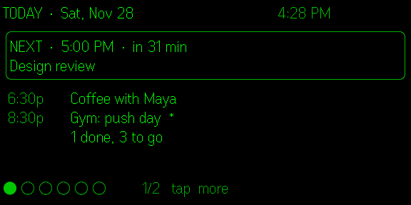
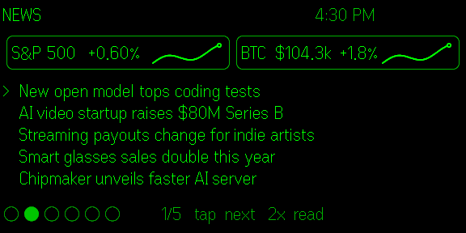
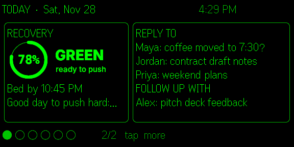
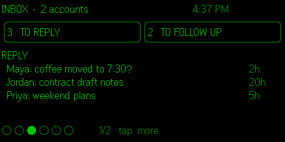
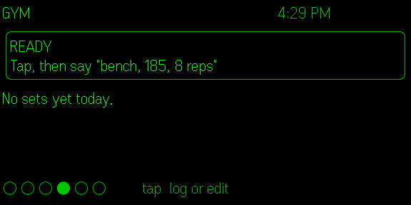
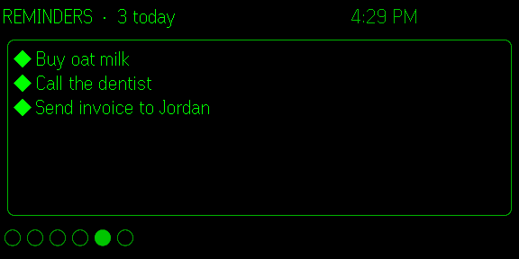
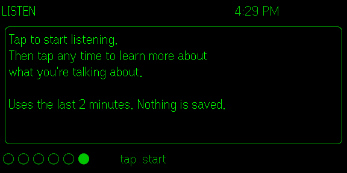
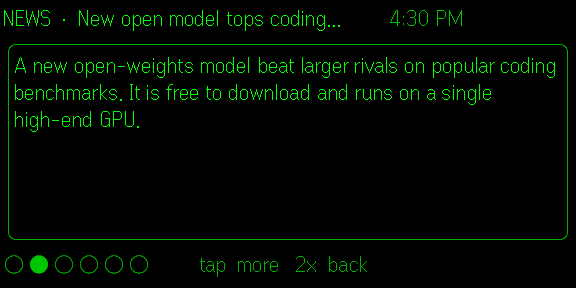
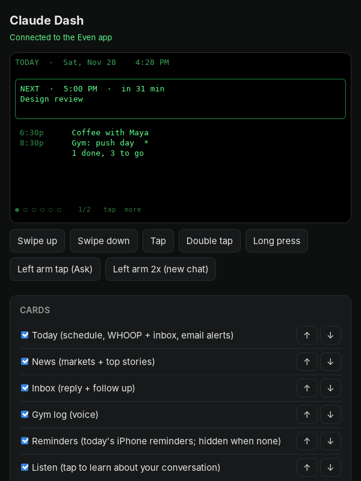

# Claude Dash

A heads-up dashboard for [Even Realities G2](https://www.evenrealities.com) smart glasses, powered by Claude.
Glance at your day, your inbox, the news and your recovery. Log gym sets by voice, ask Claude
anything, and tap during a conversation to get a quick explainer of what's being discussed.

Built on the official Even Hub SDK (`@evenrealities/even_hub_sdk` 0.0.16) and a small
Cloudflare Worker that does the thinking.

> Screenshots are from the Even Hub simulator with made-up data.

| Today | News |
|---|---|
|  |  |
| **Today, page 2** | **Inbox** |
|  |  |
| **Gym** | **Reminders** |
|  |  |
| **Listen** | **A news story** |
|  |  |



*The phone shows a settings page with a live preview of the glasses.*

## What's on the glasses

| Card | What it shows | Tap / double tap |
|---|---|---|
| **Today** | Next meeting with a countdown, the rest of today's calendar, WHOOP recovery ring, bedtime, and who to reply to | Tap: next page |
| **News** | S&P 500 and Bitcoin with sparklines, plus 5 top stories picked for your interests | Tap: next story · Double tap: read a short summary |
| **Inbox** | Emails waiting on your reply, and threads where you're waiting on someone, with how long | Tap: next page |
| **Gym** | Voice gym log: say "bench, 185, 8 reps". Edit or undo by voice, ask "what was my last bench?", a rest timer tuned by lift type and WHOOP recovery, and a summary when you say "workout complete" | Tap: talk |
| **Reminders** | Today's iPhone reminders (hidden when there are none) | Tap: next page |
| **Listen** | Listens to a conversation; tap any time for a quick explainer of what's being discussed in the last 2 minutes. Nothing is saved | Tap: explain |

Also:
- **Ask Claude** from anywhere: tap the left arm of the glasses and speak. Claude can look things up in your
  email, calendar, WHOOP, reminders, the news, and the web. Tap again to send, double tap for a new chat.
- **Email alerts**: a box pops up when an important new email arrives (newsletters and robots are filtered out).
- **Posture cat**: a small cat appears in the corner when you slouch for a while (can be turned off).
- **Battery**: glasses and R1 ring battery next to the clock.

## Controls (R1 ring or temple touchpads)

| Gesture | Action |
|---|---|
| Swipe up / down | Previous / next card |
| Tap | The card's action (see the table above) |
| Double tap | Card's second action, or back |
| Left arm tap | Open Ask Claude over any card |
| Long press | Turn the display off / on |

## How it fits together

```
 G2 glasses ◀── Bluetooth ──▶ Even app on your phone          (runs this web app: src/)
                                     │  HTTPS + your access token
                                     ▼
                       Cloudflare Worker (worker/)  ──▶  Claude API (summaries, Ask, Listen, gym)
                       KV storage for sign-ins           Groq (speech to text)
                       refreshes every 15 min    ──▶  Gmail + Google Calendar (read only), WHOOP,
                                                       news RSS feeds, market prices
```

- **`src/`** is the glasses app: a Vite + TypeScript page that runs inside the Even app and draws the cards.
  It holds no secrets.
- **`worker/`** is your private server on Cloudflare's free plan. It keeps every API key, signs in to
  Google and WHOOP with **read-only** access, and asks Claude to write the short lines you see.
  A cron job refreshes inbox, news, WHOOP and markets every 15 minutes, so the glasses never wait.
- Everything is **single user**: each person runs their own Worker with their own keys.

## Set up your own

You need: G2 glasses, the Even app, a computer with Node.js 20+, and free accounts at Cloudflare,
Anthropic and (optionally) Groq, Google Cloud and WHOOP. About 30 minutes.

### 1. Get the code

```bash
git clone https://github.com/Syedali96/claude-dash.git
cd claude-dash
npm install
```

### 2. Keys and settings

Copy the example file and fill it in. It stays on your computer (it's in `.gitignore`), and it's the
only place your keys, email addresses and account ids live.

```bash
cp .dev.vars.example .dev.vars
```

| Name | Needed for | Where to get it |
|---|---|---|
| `ANTHROPIC_API_KEY` | Everything Claude writes | [console.anthropic.com](https://console.anthropic.com) |
| `APP_TOKEN` | Locks your Worker so only your glasses can use it | Any long random string: `openssl rand -hex 32` |
| `GROQ_API_KEY` | Voice (Ask, Gym, Listen) | [console.groq.com](https://console.groq.com) |
| `GOOGLE_CLIENT_ID`, `GOOGLE_CLIENT_SECRET` | Calendar and Gmail | Step 4 below |
| `WHOOP_CLIENT_ID`, `WHOOP_CLIENT_SECRET` | Recovery, sleep, rest timer (optional) | [developer.whoop.com](https://developer.whoop.com) |
| `GOOGLE_ACCOUNTS` | Which inboxes to read, as `email:tag`. The tag shows next to each inbox item. The first account is your calendar | `me@work.com:wrk,me@gmail.com:gml` |
| `OWNER_NAME`, `ABOUT_ME` | So Claude knows who "I" is (used by Ask, Listen and News) | `Sam` and `founder of a small design studio` |
| `NEWS_INTERESTS` | What the News card favors. Leave empty for AI, startups and VC, music business, wearables and big tech | `climate tech, F1, indie games` |
| `KV_NAMESPACE_ID` | Where your sign-ins are stored | Step 3 |
| `SERVER_URL` | Your Worker's address | Step 3 |
| `PACKAGE_ID` | Your app's id on Even Hub | `com.yourname.claudedash` |

### 3. Deploy the Worker

```bash
npx wrangler login
npx wrangler kv namespace create TOKENS   # put the id it prints in KV_NAMESPACE_ID
npm run deploy                            # prints your Worker address: put it in SERVER_URL
npm run secrets                           # uploads .dev.vars to your Worker
```

Run `npm run secrets` again whenever you change `.dev.vars`. The deploy scripts fill your own ids
into git-ignored copies of `wrangler.jsonc` and `app.json`, so the committed files never hold them.

### 4. Connect Google (and WHOOP)

1. In [Google Cloud Console](https://console.cloud.google.com), create a project and enable the
   **Google Calendar API** and **Gmail API**.
2. Under **OAuth consent screen**, pick **External** (or **Internal** for a Workspace account) and add
   each of your accounts as a test user.
3. Under **Credentials → Create credentials → OAuth client ID**, choose **Web application** and add this
   redirect URI: `https://<your worker>/auth/google/callback`.
4. Put the client ID and secret in `.dev.vars`, then run `npm run secrets`.
5. Open `https://<your worker>/setup?token=<APP_TOKEN>` in your computer's browser (Google blocks
   sign-in inside the Even app) and click **Connect** for each account. Access is read-only.

WHOOP works the same way, with the redirect URI `https://<your worker>/auth/whoop/callback`.

### 5. Run it on the glasses

1. Try it in the simulator first:
   ```bash
   npm run dev      # in one terminal (uses your deployed Worker)
   npm run sim      # in another
   ```
2. On real glasses: put your phone on the same Wi-Fi as your computer, sign in at
   [hub.evenrealities.com](https://hub.evenrealities.com), open the Even app's **Even Hub** tab,
   use **Scan QR** in the developer section, and scan the code from `npm run qr`.
3. On the phone settings page, paste your Worker address and `APP_TOKEN` under **Connection**.
4. To keep it installed without your computer: `npm run pack` builds `claude-dash.ehpk`, which you can
   upload as a private beta in the Even Hub developer portal.

### Optional: iPhone reminders

Make an iPhone Shortcut that finds reminders due today and sends them with
**Get contents of URL**: `POST https://<your worker>/api/reminders`, header
`Authorization: Bearer <APP_TOKEN>`, JSON body `{"items": [...]}`. Run it from an automation
(for example every morning and when the Even app opens).

## Where to change things

| You want to change | Edit |
|---|---|
| Card order, rest times, brightness, clock, posture cat | The settings page on your phone (no code) |
| Screen layout (576×288) | `src/layout.ts` |
| What each card shows and what tap does | `src/cards.ts` |
| Gestures and refresh timing | `src/main.ts` |
| News feeds and how stories are picked | `worker/news.ts` |
| What Ask can look up | `worker/ask.ts` |
| Inbox rules (who counts as "needs reply") | `worker/gmail.ts` |
| Gym voice parsing and exercise names | `worker/gym.ts`, `src/exercises.ts` |

SDK limits worth knowing: up to 12 containers per page, 8 text boxes, 4 images, brightness 0–4, about
999 bytes per text box, and one container that receives gestures. The glasses font has no block
characters such as `█`.

## Privacy

- Google access is **read-only**: the Worker can't send, delete or change email or events.
- Email subjects, senders and snippets are sent to the Claude API to write the short summaries.
- Voice clips go to Groq for transcription and are not stored. Listen keeps only the last 2 minutes in memory.
- Sign-in tokens live in your own Cloudflare KV. Nothing is shared with anyone else.

## Credits

Drawn widgets use [Glyph](https://github.com/gabrielevierti/glyph) (MIT, © 2026 theboredprog).
The posture cat comes from [Posture Cat](https://github.com/unicco/even-g2-posture) (MIT, © 2026 Kansai Takako).
See [THIRD_PARTY_NOTICES.md](THIRD_PARTY_NOTICES.md).

## License

[MIT](LICENSE)
